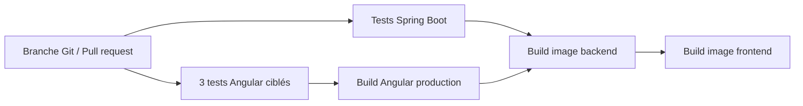

# DevOps du projet Hiring

## Architecture de la chaîne



Le workflow GitHub Actions est défini dans `.github/workflows/ci.yml`. Il se
lance après un push vers `master`, `main`, `develop` ou `feature/**`, ainsi
qu’à l’ouverture d’une Pull Request vers les branches principales. Les images
sont construites pour vérifier les Dockerfiles ; elles ne sont pas publiées
dans un registre et l’application n’est pas déployée automatiquement.

## Démarrage local avec Docker

Installer et démarrer Docker Desktop, puis depuis la racine du dépôt :

```powershell
docker compose up --build -d
docker compose ps
```

- Angular : <http://localhost:4200>
- API Spring Boot : <http://localhost:8989>
- MySQL : port `3306`
- MongoDB : port `27017`

MySQL, MongoDB et les fichiers CV utilisent des volumes Docker persistants.
`docker compose down` arrête les services sans supprimer les données. La
commande `docker compose down -v` supprime aussi les bases de démonstration.

Compose possède des valeurs de démonstration locales pour le mot de passe
MySQL et la clé JWT. Elles ne doivent pas servir en production. Pour modifier
les intégrations ou secrets, créer un fichier `.env` local à partir de
`.env.example` (si fourni) et définir au minimum `MYSQL_ROOT_PASSWORD` et
`JWT_SECRET_BASE64`. Ne jamais versionner `.env`, une clé Gemini, un jeton
LinkedIn ou des identifiants SMTP.

## Tests

Backend : trois tests unitaires couvrent le seuil de réussite du quiz et le cas
d’un quiz sans points :

```powershell
cd hiring
./mvnw.cmd test
```

Frontend : la CI exécute au maximum trois tests du tableau de candidatures :

```powershell
cd front/architectui-angular-theme-free
npm ci --legacy-peer-deps
npm run test:ci
npm run build -- --configuration production
```

Les autres fichiers `*.spec.ts` du frontend sont des squelettes Angular générés
qui échouent actuellement car leurs dépendances de test ne sont pas simulées.
Ils ne font pas partie de `test:ci`; il faudra les compléter avant d’élargir la
suite automatisée.

## Git et activation de la CI

Créer une branche courte pour chaque fonctionnalité et la pousser :

```powershell
git checkout -b feature/nom-de-la-fonction
git add .
git commit -m "feat: description courte"
git push -u origin feature/nom-de-la-fonction
```

Le push sur `feature/**` déclenche le workflow dans l’onglet **Actions** de
GitHub. Ouvrir ensuite une Pull Request vers `master` (ou `main`) et attendre
que tous les contrôles réussissent avant de fusionner. La CI vérifie le code ;
elle n’effectue ni publication d’image Docker ni déploiement.

Pour publier les images ou déployer, ajouter plus tard un workflow séparé et
des secrets GitHub propres à l’environnement cible.
